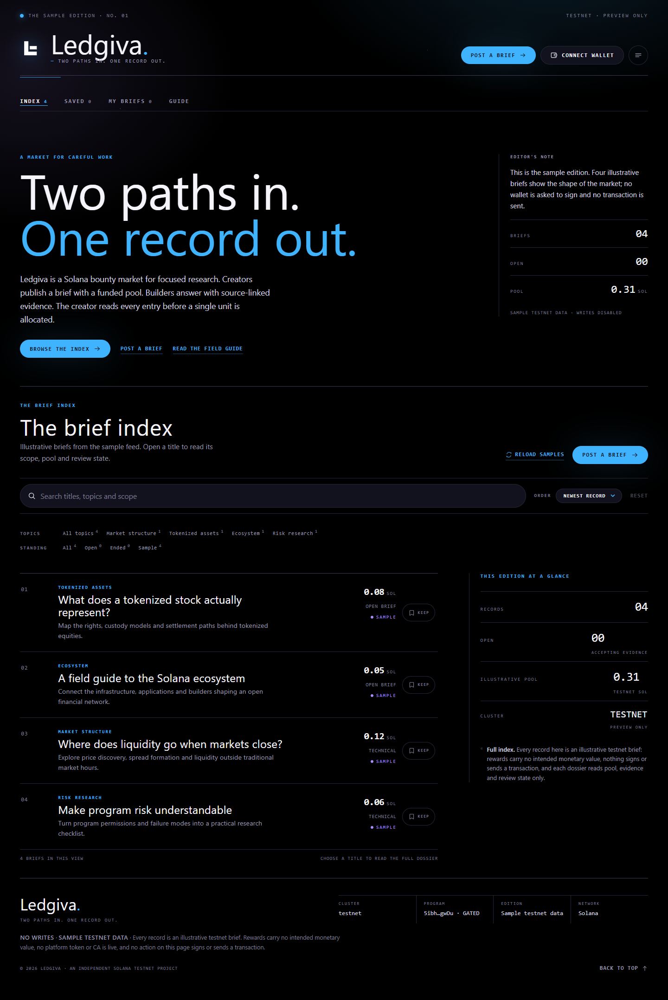
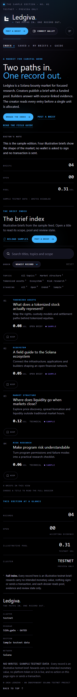
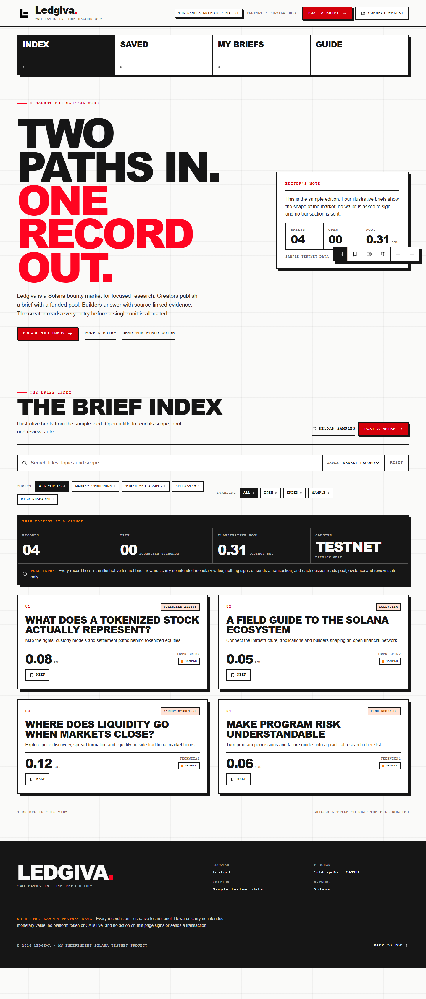
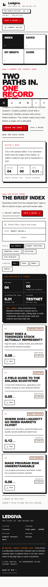

# Reskin report — Ledgiva, poster press edition

Generated 2026-10-21 (Asia/Shanghai) · Project: `E:/workspace/chuangye/solana/702/website`
Pipeline: `reskin` inventory → style selector → baseline → rebuild → verification.

## Selected direction

| Field | Value |
|---|---|
| Style | **Poster Optimism** (`optimism-poster`, performance-brutalist) |
| Source DNA | [https://www.optimism.io](https://www.optimism.io) — live sample; 9/10 references reachable, no fallback catalog used |
| Seed | `07ba73d735bb2247e2a2b9d0ffdfd2a347c906d7a49415ca75f9061e8f0226e7` |
| Skeleton | **Gallery Scroll** (`gallery-scroll`, spatial) |
| Original skeleton | `document-flow` (editorial) |
| Accent | `#40b3ff` → `#ff0421` (`#8f4b00` anchor, **105.32 ΔE**; minimum 30) |
| Ground | `#FAFAF9` paper, `#FFFFFF` plates, `#FFE3D6` wash, `#161616` ink, `#E7D5CA` lines |
| Type | Arial Black display (weight 900, −0.045em), Arial body, Courier New labels (0.1–0.18em) |

The selector sampled public blockchain sites; only abstract palette, type mood,
shape language, density and motion DNA were used — no logo, image, copy or code
from a reference was downloaded or reused.

## Skeleton and composition

The rebuilt UI is a printed poster gallery: a cream field with a paper grid, an
ink mast flag, a route wall of four oversized poster tiles, full-bleed scenes, a
floating dock of icon keys, an ink facts band, a two-column poster card wall for
the briefs, a single-print dossier and a black colophon. There is no dark
documentary field, no masthead + route index line, no 7/3 registry, no
marginalia column, no ruled ledger rows and no serif/geometric editorial shell.

| Layer | Original (documentary ledger) | Rebuilt (poster press) |
|---|---|---|
| Shell | Issue line → masthead lockup → mono route line; document body | Mast flag (brand, edition stamp, cluster stamp, actions) → route wall of 4 poster tiles → scene stack → colophon → floating dock |
| Navigation | Uppercase mono index line inside the document; full-height contents plate | Poster tiles with ink active state; a floating dock of icon keys with tooltips and `aria-label`s; a bottom contents plate on mobile |
| Discovery | 7/3 registry with ruled ledger rows | Ink facts band + two-column poster cards with stamped numbers, sticker topic chips, giant pool figures and a keep key |
| Detail | Dossier file with fact register, numbered chapters, marginalia | Single print: oversized title, sticker row, four-fact row, peach pool plate with split bar, three chapter blocks, margin notes |
| Guide | Field-guide file with numbered step register | Three step plates, rules band, FAQ stack |
| Summary | Three-column marginal figures | Four-cell ink facts band with a full-width note line |
| Overlays | Floating sheet with progress track; contents plate | Poster sheet with a stepped progress strip; bottom contents plate |
| Motion | 420 ms drift transitions | 110 ms `steps()` snap, dropped under `prefers-reduced-motion` |

## Content contract

- Pre-rebuild contract hash: `53a0606f352ef4f5ad768993c7abefdce4dbe04213f52ec9b010897d0b4a23b4`
  (188 text tokens, 163 bindings, 67 handlers).
- Post-rebuild hash: `5ff8d84d0492f12bab275c7c81b58f4b8ccac51461b83c5fe0a9ec5860a5befe`.
  The comparator reports **0 issues** and 7 additive warnings: the dock's route
  icons and `#' + item.id` anchors, two repeated handler references, and one
  additional `plus` icon attribute.
- Rendered parity on `/`: **212 words, 0 missing, 0 added**; numeric tokens
  14 / 29 total on both sides; zero removed attributes, forms or links.
- Meta title, description, document language, routes, link targets, form fields,
  handler expressions, env names and API endpoints are unchanged.

## Verification

`node scripts/verify.mjs check --project … --out .reskin` → **PASS**

| Gate | Result |
|---|---|
| Source content contract | intact — 0 issues, 7 additive warnings |
| Rendered content parity `/` | 0 missing, 0 added (212 words) |
| DOM fingerprint similarity | **0.380** ≤ 0.50 |
| Landmark sequence similarity | **0.571** ≤ 0.68 |
| CSS class overlap | **0.013** ≤ 0.10 |
| Accent distance | **105.32 ΔE** ≥ 30 |
| Route / console / page errors | `200`, 0, 0 |
| Contrast failures | **0 / 120** checked (1440 and 390) |
| Axe serious/critical | **0** (no moderate violations either) |
| Horizontal overflow | none at 1440×900 or 390×844 |
| Keyboard focus visibility | passed |
| Mobile navigation reachable | passed |
| Build | passed (`vite build`, 36.7 kB CSS / 421.3 kB JS) |

## Beyond the single capture route

The Vue app is one static route with state-driven views, so the pipeline captures
`/`. Every other view is exercised by the project suites in
`website/scripts/qa/` (wired to `npm run check:ui` and `npm run check:experience`):

- **12 captured states** at 1440 and 390 px: index, guide, saved, my briefs,
  filtered index, dossier, create sheet, review step, mobile index, contents
  plate, mobile dossier, mobile create sheet. Every state reported one `h1`, no
  horizontal overflow, no unnamed control, no missing image alt, **0 axe
  violations** and **0 console errors** (`website/.reskin/review/review.json`).
- **37/37 interaction flows** (`website/scripts/qa/flow-suite.mjs`): search,
  clear, topic filter, reset, no-match empty plate, sort by pool, ArrowDown card
  navigation, keep toggle and saved count, saved view, saved empty state,
  dossier open/back, guide + FAQ, dock switching, sheet open/Escape,
  required-field blocking, invalid URL/pool rejection, review step, edit step,
  wallet-less connect toast, back to top, mobile dock, contents navigation,
  Escape and close key.
- `npm run check:logic`: **16/16 pass**.
- `npm run check:site`: **653 checks pass** (identity, poster shell, assets,
  guard, mirror).

The pipeline screenshots, inspected side by side, share no layout signature: the
baseline is a black editorial ledger with a masthead, mono route line and ruled
ledger rows; the rebuild is a cream poster wall with an ink mast flag, route
tiles, an ink facts band and offset-shadow cards.

**Baseline**

**Current**

More states: [guide](review/02-guide-desktop.png) ·
[saved](review/03-saved-desktop.png) ·
[filtered](review/05-filtered-desktop.png) ·
[dossier](review/06-dossier-desktop.png) ·
[create sheet](review/07-create-desktop.png) ·
[review step](review/08-review-desktop.png) ·
[contents plate](review/10-contents-mobile.png) ·
[mobile dossier](review/11-dossier-mobile.png).

## Files changed

| File | Change |
|---|---|
| `src/App.vue` | New shell template (mast flag, route wall, opening/board scenes, dock, contents plate, poster sheet, banners); script unchanged except four presentational selector hooks (`#site-contents`, `.card-open`, the dock key, and the kept `.sheet-body`/`.review-brief` hooks) |
| `src/components/BriefIndex.vue` | Query bar, sticker filters, ink facts band, poster card wall, board footer |
| `src/components/BriefDossier.vue` | Single-print dossier, pool plate, split bar, chapters, entry forms, evidence cards, margin notes |
| `src/components/BriefGuide.vue` | Poster masthead, step plates, rules band, FAQ stack |
| `src/components/UiIcon.vue` | Comment updated; icon geometry unchanged |
| `src/styles/poster-press.css` | **New** presentation layer (tokens, shell, dock, board, print, guide, sheet, responsive, reduced-motion and forced-colours guards) |
| `src/styles/meridian-ledger.css` | **Removed** from the tree and the render path (archived under `.rebrand/previous/trovane-reskin-20261021/`) |
| `src/main.js` | Imports the new stylesheet |
| `scripts/check-site.mjs` | Guard rewritten for the poster shell and the new assets |
| `scripts/qa/*` | New state audit, flow suite and preview runner; `check:ui`/`check:experience` repointed |
| `scripts/check-ui.mjs`, `scripts/check-experience.mjs` | Retired to `archive/retired-qa/` (they asserted the previous edition) |
| `a702/**` | Distribution mirror resynchronised |

The application logic (`src/composables/useMissions.js`, `src/utils/*.js`,
`src/config.js`), sample data, routes, localStorage keys and wallet/transaction
gates were not modified apart from adding `trovane-saved` to the legacy bookmark
key list so existing saved lists migrate to `ledgiva-saved`.

## Accessibility and responsive behaviour

- One `h1` per view; landmark order is header → main → navigation → contentinfo;
  the route wall is the only visible route index, and the dock is icon-only at
  desktop with `aria-label`s and tooltips.
- 3 px `#d4000a` focus ring with 2 px offset on every interactive element; the
  skip link remains the first focusable item and is revealed on focus.
- All body text ≥ 4.5:1 on paper (0 contrast failures across 120 checks); red is
  reserved for large figures and shapes, with `#d4000a` behind white text.
- Mobile is a genuinely linear composition: mast flag, route wall, opening
  scene, board, colophon, full-width dock bar; the contents plate is a bottom
  plate with focus trapping and Escape close. No horizontal overflow at 390 px.
- `prefers-reduced-motion` removes the flicker/pulse and hover translations;
  `forced-colours` hands borders and fills to the system palette.

## Known limitations

- `verify.mjs` captures only the single static route `/`; the state-driven views
  are covered by the 12-state audit and 37-flow suite rather than by the
  pipeline's screenshot pair.
- No wallet is available in this environment, so the connected-wallet branches
  (creator approval, refund, claim, live submission) were not exercised
  visually; their code and copy are unchanged.
- The `a702/` distribution mirror and `archive/` were held outside the scan root
  while the baseline contract was frozen, so the contract is measured on the app
  source once; both are restored in the shipped tree and `check:site` verifies
  the mirror.
- The selected style is Poster Optimism and the skeleton is Gallery Scroll; the
  shipped surface classifies as `gallery-scroll` (spatial), with the poster
  palette and hard-shadow grammar carrying the reference DNA.

> The UI was rebuilt around **Poster Optimism** / **Gallery Scroll**; the original **document-flow** shell and palette were removed while the content contract stayed byte-for-byte intact.
