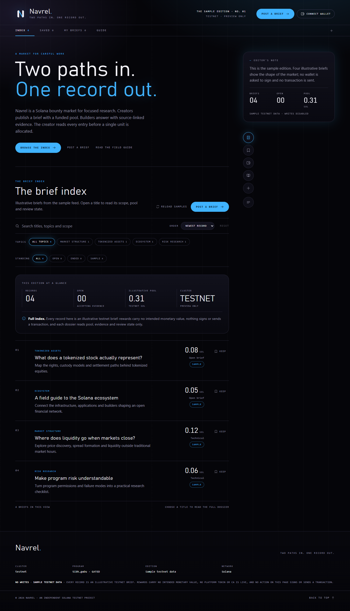
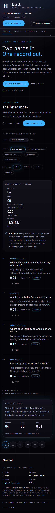
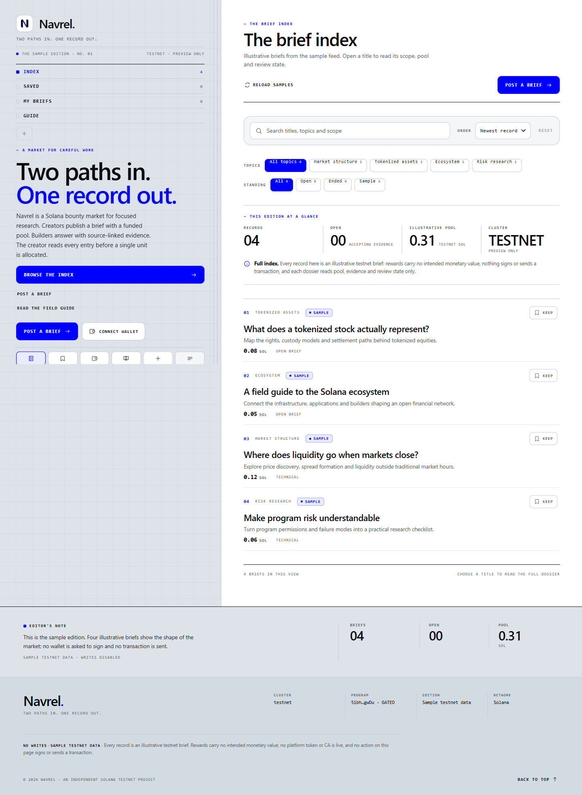
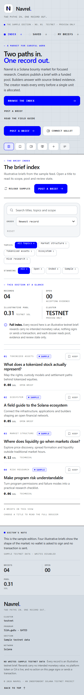

# Reskin report — Navrel, cobalt blueprint edition

Generated 2026-11-10 (Asia/Shanghai) · Project: `E:/workspace/chuangye/solana/702/website`
Pipeline: `reskin` inventory → style selector → baseline → rebuild → verification.

## Selected direction

| Field | Value |
|---|---|
| Style | **Cobalt Blueprint** (`base-cobalt`, optimistic-modern) |
| Source DNA | [https://www.base.org](https://www.base.org) — live sample; 8/10 references reachable, no fallback catalog used |
| Seed | `b00478b2499231c12406cfa0b512feeeea03ce5f5d11b202d73eb5be3863a474` |
| Skeleton | **Split Stage** (`split-stage`, spatial) |
| Original skeleton | `document-flow` (editorial) |
| Accent | `#40b3ff` → `#0000ff` (**112.45 ΔE**; minimum 30) |
| Ground | `#dde3e9` cool paper, `#ffffff` data sheet, `#e9ebff` cobalt tint, `#c3cbd4` hairlines |
| Type | Segoe UI display at 640 weight, −0.035em tracking; Segoe UI body; Cascadia Mono / Consolas labels |

The selector sampled public blockchain sites; only abstract palette, type mood,
shape language, density and motion DNA were used — no logo, image, copy or code
from a reference was downloaded or reused.

The shipped surface classifies as `sidebar-workspace` (family `shell`) rather than
`document-flow` (family `editorial`): the classifier has no `split-stage` label,
and the sticky narrative rail is read as a sidebar. The gate requires a different
archetype *and* family, which this satisfies; the layout below is the split stage.

## Skeleton and composition

The rebuilt UI is a blueprint sheet: a cool-paper ground with a 40 px grid, a
sticky narrative rail that carries the brand, the route index, the page thesis and
the primary actions, one white data sheet for the data, a full-width edition band,
and a colophon. There is no dark field, no top masthead, no ruled index line under
a bar, no floating compass column, no card grid and no cream poster press.

| Layer | Original (night sheet) | Rebuilt (blueprint) |
|---|---|---|
| Shell | Dateline masthead → ruled index line → plate + complementary margin → colophon | Sticky rail (brand, route index, thesis, actions, route keys) + white data sheet → edition band → colophon |
| Navigation | Horizontal ruled index line + floating circular compass keys in the margin | Vertical route index in the rail with counts, plus a hairline route-key dock at the foot of the rail; mobile is a scrollable strip and the same keys |
| Discovery | Query rail, facet pills, four-cell tally plate, hairline ledger rows | Stage head, bordered control strip, chip sets, tally band with rules, stacked register entries |
| Detail | Dossier sheet: head, ruled case ledger, vault plate, three chapters, marginalia | Case file: case bar, facts strip, vault band with split rail, three numbered chapters with a cobalt gutter, two-up entry forms, evidence rows, marginalia band |
| Guide | Guide head, numbered stair, creed sections, FAQ stack | Guide head, numbered stair rows, creed rule grid, FAQ disclosures with rotating keys |
| Summary | Edition note card in the margin | Full-width edition band with three printed figures |
| Overlays | Dark ledger dialog; bottom contents plate | White draft sheet dialog with cobalt step rule; bottom contents sheet |
| Motion | 420 ms eased moves | 170 ms crisp moves, removed under `prefers-reduced-motion` |

## Content contract

- Baseline hash: `d2be4022d8c3f0893d496500270b84ca06471abcf1c3754e1faea6cbd5a193cb`
  (188 visible text tokens, 167 bindings, 70 handlers, 11 form fields, 5 form
  signatures).
- Post-rebuild hash: **identical** — the comparator reports **0 issues and 0
  additive warnings**.
- Rendered parity on `/`: **212 words, 0 missing, 0 added**; numeric tokens 29 / 29
  on both sides; zero removed attributes, forms, handlers or links.
- Two accessibility-only differences are reported as warnings: the margin's
  `aria-label="Edition notes"` moved to `aria-label="Edition notice"` on the band,
  and the rail gained `aria-label="Narrative rail"`.
- Meta title, description, document language, routes, link targets, form fields,
  handler expressions, env names and API endpoints are unchanged. The one CSS
  `content` token (`"\2014"`) is preserved.

## Verification

`node scripts/verify.mjs check --project … --out .reskin` → **PASS**

| Gate | Result |
|---|---|
| Source content contract | intact — 0 issues, 0 additive warnings |
| Rendered content parity `/` | 0 missing, 0 added (212 words) |
| DOM fingerprint similarity | **0.297** ≤ 0.50 |
| Landmark sequence similarity | **0.600** ≤ 0.68 |
| CSS class overlap | **0.006** ≤ 0.10 |
| Accent distance | **112.45 ΔE** ≥ 30 |
| Archetype | `document-flow` (editorial) → `sidebar-workspace` (shell) |
| Route / console / page errors | `200`, 0, 0 |
| Contrast failures | **0 / 119** checked (1440 and 390) |
| Axe serious/critical | **0** (no moderate violations either) |
| Horizontal overflow | none at 1440×900 or 390×844 |
| Keyboard focus visibility | passed |
| Mobile navigation reachable | passed |
| Build | passed (`vite build`, 46.9 kB CSS / 422.2 kB JS) |

## Beyond the single capture route

The Vue app is one static route with state-driven views, so the pipeline captures
`/`. Every other view is exercised by the project suites:

- **12 states** at 1440 and 390 px: index, guide, saved, my briefs, filtered
  index, dossier, create dialog, review step, mobile index, contents sheet, mobile
  dossier, mobile create dialog. Every state reported one `h1`, no horizontal
  overflow, no unnamed control, no missing image alt, **0 axe violations** and
  **0 console errors** (`website/.reskin/review/review.json`).
- **37/37 interaction flows** (`website/scripts/qa/flow-suite.mjs`): search, clear,
  topic facet, reset, no-match empty state, sort by pool, ArrowDown row navigation,
  keep toggle and saved count, saved view, saved empty state, dossier open/back,
  guide + FAQ, route-key switching, dialog open/Escape, required-field blocking,
  invalid URL/pool rejection, review step, edit step, wallet-less connect strip,
  back to top, mobile keys, contents navigation, Escape and close key.
- `check:logic`: **16/16 pass**.
- `check:site`: **780 checks pass** (identity, blueprint shell, assets, retired
  editions, guard, mirror).

## Brand and X kit

The brand surface moved with the site, so the X kit and the site assets cannot
drift:

- Palette and display face switched in `twitter/generate_assets.py` (cool paper,
  ink stems, one cobalt diagonal), and `generate_edition_assets.py` re-emitted the
  favicon, seal, mark and Open Graph card from the same mark geometry.
- All eight social PNGs, the contact sheet, the silent loop and `content.txt` were
  regenerated; `navrel-rebuild-card.png` is new and maps the split stage with the
  frozen contract printed as a strip.
- Profile bio, pinned post and publish order are written into `twitter/content.txt`;
  the full build-in-public series (9 standalone posts, `D0` → `D13`, 2 visual / 7
  text, media briefs for both visual posts) is `twitter/navrel-x-series.md` and
  passes the writex linter with 0 errors (one expected warning: there is no token,
  so no cashtag exists).

## Files changed

| File | Change |
|---|---|
| `src/App.vue` | New split-stage shell (rail, stage, band, colophon, contents sheet, draft dialog, toasts); script unchanged except the presentational hooks `bp-entry-open`, `#bp-contents`, `.bp-key[aria-controls=…]`, `.bp-dialog-body`, `.bp-preview h3` |
| `src/components/BriefIndex.vue` | Stage head, control strip, chips, tally band, stacked register entries with keyboard navigation |
| `src/components/BriefDossier.vue` | Case bar, facts strip, vault band, numbered chapters, two-up forms, evidence rows, marginalia band |
| `src/components/BriefGuide.vue` | Guide head, numbered stair rows, creed grid, FAQ disclosures |
| `src/components/UiIcon.vue` | Stroke 1.4 → 1.5; glyph names unchanged |
| `src/styles/blueprint.css` | **New** presentation layer (tokens, shell, register, case file, guide, band, dialog, sheet, responsive, reduced motion, forced colours) |
| `src/styles/nightsheet.css` | **Removed** from the tree and the render path (archived at `archive/reskin-night-sheet-20261022/nightsheet.css`) |
| `src/main.js` | Imports the new stylesheet |
| `index.html` | `color-scheme` light and `theme-color` `#dde3e9` |
| `public/*` | Favicon, seal, mark and edition social card regenerated in cobalt |
| `scripts/check-site.mjs` | Guard rewritten for the blueprint shell; retired night-sheet names added |
| `scripts/qa/*` | State audit and flow suite repointed to the blueprint selectors |
| `README.md` | Interface and identity sections rewritten for this edition |
| `twitter/*` | Palette/type, rebuild card, regenerated PNGs + loop, `content.txt`, `navrel-x-series.md`, README |
| `a702/**` | Distribution mirror resynchronised and rebuilt |

The application logic (`src/composables/useMissions.js`, `src/utils/*.js`,
`src/config.js`), sample data, routes, localStorage keys and wallet/transaction
gates were not modified.

## Accessibility and responsive behaviour

- One `h1` per view; landmarks are the complementary rail (`aside`), the route
  `nav`, `main` and the `footer`; the rail is labelled and the route keys are a
  labelled group with `aria-pressed` state.
- 2 px `#0000ff` focus ring with 2 px offset on every interactive element; the skip
  link is the first focusable item, hidden with `clip-path` until focused.
- All body text ≥ 4.5:1 on the paper ground (0 failures across 119 checks); the
  muted token is `#565b63`.
- Mobile is a genuinely linear composition: brand block, horizontally scrollable
  route index, thesis, actions, route keys, then the data sheet and the band. No
  horizontal overflow at 390 px.
- `prefers-reduced-motion` stops the sweep and beat animations and the hover
  transitions; `forced-colours` hands borders and fills to the system palette.

## Known limitations

- `verify.mjs` captures only the single static route `/`; the state-driven views
  are covered by the 12-state audit and the 37-flow suite rather than by the
  pipeline's screenshot pair.
- No wallet is available in this environment, so the connected-wallet branches
  (creator approval, refund, claim, live submission) were not exercised visually;
  their code and copy are unchanged.
- The `a702/` distribution mirror and `archive/` were held outside the scan root
  while the source contract was frozen and checked, because both trees contain
  `.vue`/`.css` copies that the inventory would otherwise count twice. Both are
  restored in the shipped tree and `check:site` verifies the mirror.
- The selected style is Cobalt Blueprint and the skeleton is Split Stage; the
  shipped surface classifies as `sidebar-workspace` (shell).

## Screenshots

**Baseline (night sheet)**

**Current (cobalt blueprint)**

More states: [guide](review/02-guide-desktop.png) ·
[saved](review/03-saved-desktop.png) ·
[dossier](review/06-dossier-desktop.png) ·
[create dialog](review/07-create-desktop.png) ·
[review step](review/08-review-desktop.png) ·
[contents sheet](review/10-contents-mobile.png) ·
[mobile dossier](review/11-dossier-mobile.png).

> The UI was rebuilt around **Cobalt Blueprint** / **Split Stage**; the original **document-flow** shell and palette were removed while the content contract stayed byte-for-byte intact.
